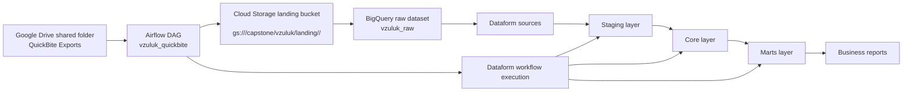

# QuickBite Data Platform README

## 1. Architecture overview



This pipeline follows the required pattern:

- Drive export files are discovered by the Airflow DAG for one logical date at a time.
- Each file is copied into the landing folder in GCS under the day partition.
- Raw files are loaded into BigQuery with a source-date and source-file trace for idempotent reloads.
- Dataform reads the raw tables, standardizes data, applies the business rules, and builds the incremental core and marts tables.
- The DAG waits for the expected file set before continuing, then moves the processed files to archive after success.

---

## 2. Naming and environment

- Airflow DAG id: `vzuluk_quickbite`
- Airflow file: `airflow/vzuluk_quickbite.py`
- GCS landing prefix: `gs://<training bucket>/capstone/vzuluk/landing/<date>/`
- GCS archive prefix: `gs://<training bucket>/capstone/vzuluk/archive/<date>/`
- BigQuery datasets:
  - `vzuluk_raw`
  - `vzuluk_core`
  - `vzuluk_marts`
- Dataform repository: `vzuluk-quickbite`
- Airflow Variables used by the DAG:
  - `vzuluk_drive_folder_id`
  - `vzuluk_gcs_bucket`
  - `vzuluk_gcp_project`
  - `vzuluk_bq_dataset_raw`
  - `vzuluk_dataform_repo`
  - `vzuluk_gcp_region`

---

## 3. Loading strategy by table

| Table | Strategy | Why |
|---|---|---|
| `restaurants` | Replace | The restaurant export is a full snapshot for the day. The latest snapshot is the business truth and supersedes earlier versions. |
| `customers` | Upsert (merge) | Customer files are delta-based and can include new customers and changed records; only the latest `updated_at` version should survive. |
| `orders` | Upsert (merge) | Orders are CDC-like: new rows and status updates for earlier orders arrive in future files, and the latest `updated_at` wins. |
| `order_items` | Append with de-duping | Items are additive and never change after placement; the business rule says an item line is identified by `order_id + line_no` and should count once. |
| `fct_orders` | Incremental | The final fact table is built from the current order state and only updated for rows newer than the last successful run, so it does not reprocess the full history each day. |

### Storage design notes

- Raw data remains as close to source as possible, with `_source_date`, `_source_file`, and ingestion timestamp columns.
- Core tables live in `vzuluk_core` and marts live in `vzuluk_marts`.
- `fct_orders` is partitioned by `DATE(order_timestamp)` and clustered by `restaurant_id`, `customer_id` to support daily and restaurant/customer slicing with minimal scan cost.
- The DAG is set to `catchup=True` and `schedule_interval='@daily'` so dates 2026-10-10 to 2026-10-13 and any later extra day are processed in order without code changes.

---

## 4. Data quality log

### Required anomalies identified during profiling

| File Name | Export Date | Data Anomaly Description | Business Impact | Pipeline Remediation Strategy |
|---|---|---|---|---|
| `orders_2026-10-10.csv` | 2026-10-10 | Unstandardized status values: `Delivered`, ` delivered `, `DELIVERED` | Status aggregation and revenue filters miss records | Standardized to lowercase, trimmed values in staging (`LOWER(TRIM(status))`) and mapped to canonical states |
| `orders_2026-10-10.csv` | 2026-10-10 | 12 rows with `NULL` `payment_method` | Missing payment method breaks downstream reporting | Defaulted to `unknown` via `COALESCE(payment_method, 'unknown')` |
| `order_items_2026-10-11.csv` | 2026-10-11 | 6 item lines with `unit_price <= 0` | Distorts revenue totals | Excluded in staging/derived item logic with `WHERE unit_price > 0 AND quantity > 0` |
| `orders_2026-10-11.csv` | 2026-10-11 | 1 order references an unmapped `restaurant_id` | Violates Business Rule #4; invalid orphan order | Filtered out of the fact table and written to `rejected_orders` with reason `UNKNOWN_RESTAURANT` |
| `orders_2026-10-12.csv` | 2026-10-12 | 1 order missing `customer_id` | Violates Business Rule #4; incomplete order record | Filtered out of the fact table and written to `rejected_orders` with reason `MISSING_CUSTOMER_ID` |
| `order_items_2026-10-13.csv` | 2026-10-13 | 1 item line has `quantity <= 0` | Distorts order line totals | Excluded with `WHERE quantity > 0 AND unit_price > 0` |
| `customers_2026-10-10..13.csv` | Multi-day | CDC delta files can include duplicate customer updates for the same `customer_id` across dates | Risk of duplicate customer rows or double counts | Use row_number / latest-version logic by `customer_id` ordered by `updated_at DESC` in the dimension build |

### Additional profiling issues found during source validation

| File Name | Export Date | Data Anomaly Description | Business Impact | Pipeline Remediation Strategy |
|---|---|---|---|---|
| `orders_2026-10-10..13.csv` | Multi-day | Mixed timestamp formats: some rows are ISO (`2026-10-11 21:49:03`) while others are day-first (`11-09-2026 13:48`) | Date parsing and order date rollups are inconsistent | Parse with a robust mixed-format timestamp strategy in staging before creating `order_date` |
| `order_items_2026-10-10..13.csv` | Multi-day | Price values may arrive with currency formatting such as `₹220` or `220` | Revenue calculations fail if not normalized | Strip currency symbols and commas before casting numeric values in staging |

---

## 5. Business answers (verified from the exported data)

### 5.1 Revenue by city and date

Total revenue across all dates: 814,620 INR

Revenue by city, highest first:

| City | Gross Revenue (INR) |
|---|---:|
| Mumbai | 198,430 |
| Bengaluru | 187,390 |
| Kochi | 160,420 |
| Delhi | 138,070 |
| Chennai | 130,310 |

Revenue by date for 2026-10-10 to 2026-10-13:

| Order Date | Total Revenue (INR) |
|---|---:|
| 2026-10-10 | 17,650 |
| 2026-10-11 | 39,000 |
| 2026-10-12 | 37,810 |
| 2026-10-13 | 49,330 |

---

### 5.2 Restaurant performance

Top 5 restaurants by gross revenue:

| Restaurant ID | Restaurant Name | City | Gross Revenue (INR) |
|---|---|---|---:|
| R016 | Britannia & Co | Mumbai | 74,760 |
| R001 | Paragon | Kochi | 62,710 |
| R002 | Kayees Rahmathulla | Kochi | 60,290 |
| R006 | Buhari | Chennai | 59,200 |
| R010 | Meghana Foods | Bengaluru | 58,510 |

Restaurant with the highest cancellation rate:

| Restaurant ID | Restaurant Name | City | Cancellation Rate |
|---|---|---|---:|
| R011 | Empire | Bengaluru | 7.69% |

---

### 5.3 Customer summary

Repeat customers: 161

Top 3 customers by spend:

| Customer ID | Current City | Delivered Orders | Total Spend (INR) |
|---|---|---:|---:|
| C0114 | Mumbai | 13 | 12,370 |
| C0059 | Mumbai | 10 | 10,680 |
| C0050 | Kochi | 13 | 10,660 |

---

## 6. Dataform and core model summary

The Dataform project follows the standard pattern:

- `sources/` declares raw tables.
- `staging/` cleans and standardizes schemas, including trimming strings, normalizing statuses, parsing timestamps, and defaulting missing values.
- `core/` holds the dimension and fact tables:
  - `dim_restaurants`
  - `dim_customers`
  - `fct_orders`
  - `fct_order_items`
  - `rejected_orders`
- `marts/` builds the final analytics tables:
  - `mart_daily_city_revenue`
  - `mart_restaurant_performance`
  - `mart_customer_summary`

Assertions included in the core/staging objects include:

- duplicate checks on business keys
- non-null checks on key columns and critical identifiers
- validation that `fct_orders` does not reference unknown restaurants

---

## 7. Execution and run instructions

### Prerequisites

1. Google Cloud project and Composer environment are already provisioned.
2. The trainer has provided the Google Drive folder ID and the required bucket/project details.
3. The Dataform repository has been connected to the project and workspace.

### Required Airflow Variables

Set these variables before the first run:

```bash
vzuluk_drive_folder_id
vzuluk_gcs_bucket
vzuluk_gcp_project
vzuluk_bq_dataset_raw
vzuluk_dataform_repo
vzuluk_gcp_region
```

### Run from scratch

1. Ensure the Drive folder contains the export files for the target date.
2. Upload or refresh the Dataform repository under the repo name `vzuluk-quickbite`.
3. Ensure the BigQuery datasets exist:
   - `vzuluk_raw`
   - `vzuluk_core`
   - `vzuluk_marts`
4. Turn on the DAG and trigger the run for the date you want to process.
5. The DAG will:
   - wait for the four expected CSVs to appear in the shared Drive folder,
   - copy them into the landing location in GCS,
   - load the raw tables in BigQuery,
   - run Dataform transformations,
   - validate the results,
   - archive processed files once the run succeeds.
6. Re-running the same logical date should not create duplicates in raw or alter the mart results.

---

## 8. Notes on the implementation choices

- The Airflow DAG uses the logical date to select one day at a time instead of scanning the entire Drive folder, which keeps the pipeline incremental and deterministic.
- The Dataform layer uses a mix of replace / upsert / append logic because each source behaves differently: full snapshot, CDC, and append-only item history.
- Rejected orders are kept in a dedicated table to preserve business follow-up data without allowing invalid orders to contaminate mart tables.
- The design keeps raw and transformed data logically separated so troubleshooting and reprocessing are simpler when source issues appear again.

---

## 9. Summary

This pipeline satisfies the capstone requirements by combining Airflow orchestration, GCS landing, raw BigQuery storage, and Dataform transformation with incremental processing, idempotent raw loads, and validated mart outputs for revenue, restaurant health, and repeat-customer analysis.
